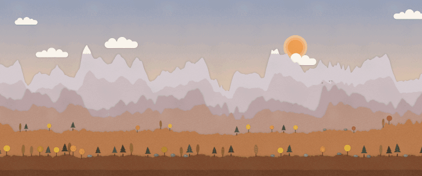
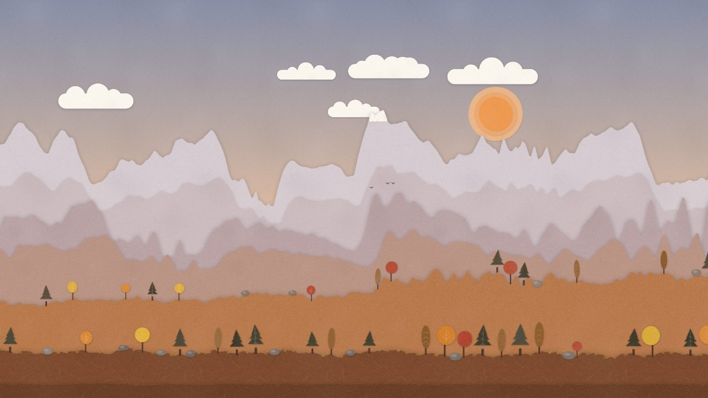
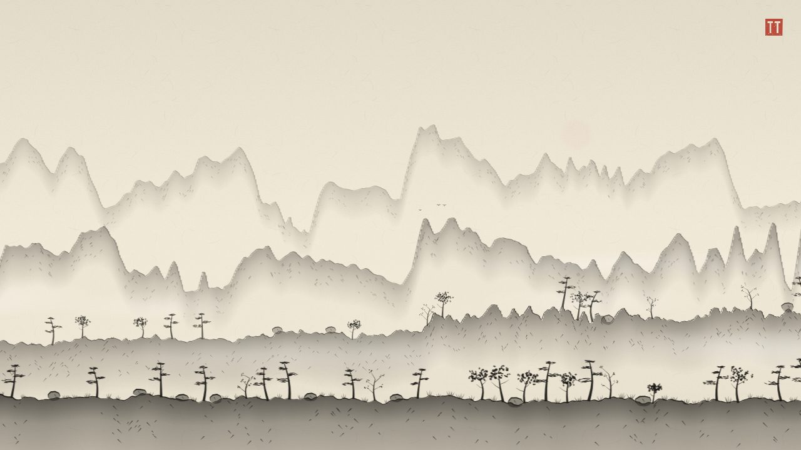
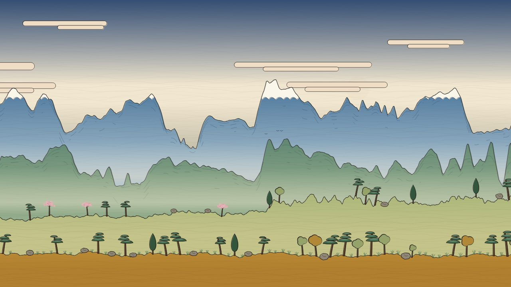

# Topotone

Sound turned into a landscape. A song, your microphone, or the page's own quiet music drives a world that scrolls past, drawn as a paper cutout, an ink painting or a ukiyo-e woodblock print.

**[Open it in your browser](https://yodim.github.io/topotone/).** There is nothing to install, and your audio never leaves your device.



The melody raises the mountains, beats plant trees, the bass carves rivers, and a silence leaves a still lake under the mist. With no sound at all, a seeded source that behaves like music keeps the land moving. Switch the style at any moment and the very same world is redrawn. When the song ends, export the whole thing as one long panorama.

| Paper cutout                                                    | Ink painting                                                  | Ukiyo-e woodblock                                                     |
| --------------------------------------------------------------- | ------------------------------------------------------------- | --------------------------------------------------------------------- |
|  |  |  |

More reference screenshots, three seeds for each style, are in [docs/screenshots](docs/screenshots).

## Trying it

Every action has a button along the bottom of the page, so it all works by touch on a phone. On a computer each button also has a key. The buttons dim when nothing moves, and in fullscreen they hide with the cursor until the next touch or key.

- **Song** (`O`) plays a song from your device. You can also drop one anywhere on the page. It is analyzed first, then played. **Pause** (`Space`) shows up while a song is loaded.
- **Mic** (`M`) listens to the microphone. New land grows at the right as it is heard. Press it again to hand back to the landscape's own music.
- **Style** (`1`, `2`, `3`) switches between the paper cutout, ink and ukiyo-e styles, with a short crossfade. The button steps through them and shows the one on screen.
- **New world** (`S`) picks a new seed. A song or the mic keeps playing; only the land and the landscape's own music change.
- **Export** (`E`) saves a panorama as a PNG: the whole song, the mic session so far, or the last stretch of the landscape. Every layer is laid out at the same speed, so the image reads from left to right like the music. A caption strip with the title, seed, style and date is optional.
- In the top left corner, **Fullscreen** (`F`) and **About** (`A`): what Topotone is, the keys, privacy and credits. `Escape` closes a panel.
- `D` shows the feature meters, the playhead and the frame rate.

With reduced motion turned on in the system settings, the landscape's own music runs at half speed, fades are slower and the mist drifts less. Songs and the mic keep real time.

The address holds the rest:

- `?seed=river` picks a world. Any text or number works, and the same seed always gives the same world. Without one, a random seed is chosen and written into the address bar. New world writes its seed there too.
- `?style=paper` picks a style, and `?style=debug` shows the wireframe used for development.
- `?speed=4` runs the music faster (from 0.05 to 50).
- `?tune` opens the tuning panel: one slider per mapping value. Changes rebuild the land and are kept in your browser; `Copy JSON` gives the values you changed, and `T` hides the panel.

Your audio never leaves your device. There are no network calls, analytics or uploads.

## How it works

```
audio source ──► feature frames ──► mapping ──► generator ──► layer chunks ──► engine ──► style
(file, mic,      (pure data,        (music to   (seeded,       (pure data,      (camera,    (draws
 synthetic)       values 0..1)       intents)    deterministic)  no colors)       caching)    pixels)
```

- **Sources.** A song is analyzed in full in a worker before it plays, so the world ahead of the playhead is already known. The mic is analyzed as it is heard. Both give the same feature frames: loudness, three bands, brightness, pitch and onsets. The landscape's own music is a seeded source that emits those frames too, which is how the land keeps moving with no sound at all.
- **Mapping and generator.** The mapping turns features into intents (how high, how dense, where the water is), and the generator builds the world from them in chunks of 4 seconds per layer, with seeded noise for the detail. The same seed and the same music always give the same world, which is what lets the export rebuild a whole song exactly.
- **Engine and styles.** The engine caches each chunk as a canvas and slides the four layers past at their own speeds. A style only draws: it gets ridges, trees, water and the sky as shapes and paints them its own way. Adding a style never touches the terrain code.

The contracts between the parts live in `src/audio/features.ts`, `src/world/scene.ts` and `src/styles/types.ts`. Everything is TypeScript on Canvas 2D, with no runtime dependencies: the random numbers, the noise, the FFT and the textures are written here.

### The musical mapping

This table is where the project gets its personality. Every value lives in `src/world/mapping.ts`, with comments, and can be tuned live with `?tune`.

| Heard                                                   | Smoothing          | Becomes                                                |
| ------------------------------------------------------- | ------------------ | ------------------------------------------------------ |
| Pitch or brightness, relative to the last 30 s of music | 1 s and 3 s        | Height of the middle and far mountain ranges           |
| Loudness (RMS)                                          | about 0.6 s        | Height and ruggedness of the foreground hills          |
| Onsets in the high band (hi-hats, plucks)               | none               | Grass tufts and small trees                            |
| Onsets in the low and mid bands (kicks, strong notes)   | none               | Large trees and rocks, size from onset strength        |
| Sustained low-band energy (bass, drones)                | about 1 s          | A river appears, its width follows the bass            |
| Long silence (more than about 2 s)                      | n/a                | A flat plain or a still lake, mist rises               |
| Long-term energy                                        | about 10 s         | Sky mood: calm and clear to dramatic and clouded       |
| Overall brightness of the track                         | whole song or 30 s | Palette temperature hint (styles may use or ignore it) |
| Crescendo, a sudden big peak in loudness                | n/a                | A tall lone peak, or a flock of birds taking off       |
| A drop: a crescendo after a build-up                    | n/a                | A taller peak, birds, and a lift in the hills          |

Far layers follow the slow, heavily smoothed features and near layers the fast ones. Seeded noise always adds the fine detail on top, so the music sets the shape without turning the land into an oscilloscope.

## Running it locally

You need Node 22 or newer.

```
npm ci
npm run dev        # local dev server, at http://localhost:5173/
npm run build      # production build for GitHub Pages
npm run preview    # serve the build
npm run test       # unit tests
npm run test:e2e   # browser tests (run `npx playwright install chromium` once first)
                   # UPDATE_SCREENSHOTS=1 npm run test:e2e -- screenshots refreshes docs/screenshots
npm run lint       # eslint and prettier check
npm run typecheck  # tsc
npm run fixtures   # write the test signals as WAV files to tests/fixtures/out/
npm run media      # remake docs/topotone.gif and docs/social-preview.jpg from the app
```

## Layout

```
src/
  main.ts                 bootstrap
  app/                    buttons, About and export panels, URL params, keyboard, drag and drop,
                          file checks, audio on phones
  core/                   rng.ts (the only randomness), noise.ts, math.ts
  audio/                  features.ts (contract), cache.ts, fft.ts, extractor.ts,
                          normalize.ts, analysis.ts, analysis.worker.ts, stream.ts,
                          mic.worklet.ts
    sources/              synthetic.ts, file.ts, mic.ts, manager.ts
  world/                  scene.ts (contract), mapping.ts, signal.ts, generator.ts, store.ts
  render/                 engine.ts, strip.ts, chunk.ts, camera.ts, export.ts
  styles/                 types.ts (contract), registry.ts, shared/, _template/, debug/,
                          paper/, ink/, ukiyoe/
tests/                    unit tests, e2e/ browser tests, fixtures/ (code-generated signals)
scripts/                  test signals as WAV files, the README animation and its GIF encoder
docs/                     the animation, the social preview, screenshots/
```

To make a style of your own, start from `src/styles/_template/`.

## Contributing

New styles, mapping ideas and fixes are welcome. [CONTRIBUTING.md](CONTRIBUTING.md) explains the rules that keep the world seamless and walks through adding a style and tuning the mapping. Issues labelled [good first issue](https://github.com/yodim/topotone/labels/good%20first%20issue) are a good place to start. Everyone taking part follows the [code of conduct](CODE_OF_CONDUCT.md).

[PLAN.md](PLAN.md) holds the build plan, the design notes and what may come after version 1.

## License

MIT, see [LICENSE](LICENSE).
